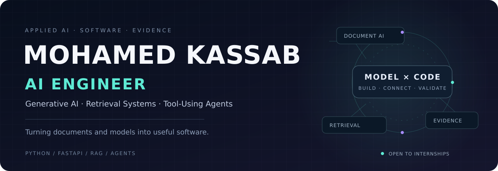

  

  <strong>Practical AI applications. Clear engineering. Evidence you can inspect.</strong>

  <a href="#featured-project-tenderproof-ai">TenderProof AI</a> &nbsp; / &nbsp;
  <a href="#selected-projects">Selected Projects</a> &nbsp; / &nbsp;
  <a href="#engineering-toolkit">Toolkit</a> &nbsp; / &nbsp;
  <a href="https://www.linkedin.com/in/mohamedkaasab/">LinkedIn</a> &nbsp; / &nbsp;
  <a href="mailto:m.kassab934@gmail.com">Contact</a>

---

## About me

I'm **Mohamed Kassab**, a final-year Artificial Intelligence student at **Kafrelsheikh University, Egypt**, focused on **AI engineering, Generative AI, retrieval-augmented generation, and tool-using agents**.

I enjoy the work that connects a model to a useful application: preparing documents, designing retrieval and tool workflows, defining structured outputs, connecting APIs, and making results understandable to the person using them.

| Focus | What I work on |
| --- | --- |
| **Document AI & RAG** | PDF processing, retrieval pipelines, structured information, and source-linked findings |
| **Agents & applications** | Tool calling, Python orchestration, FastAPI services, and practical interfaces |
| **Machine learning & data** | Feature engineering, classification, evaluation, SQL, and analytics |

**Background:** Samsung Innovation Campus AI Track and team projects · Previously Data Analysis Mentor at Microsoft Student Club.

**Open to:** AI / GenAI engineering internships, junior opportunities, and open-source collaboration.

## Featured project: TenderProof AI

<table>
<tr>
<td>

### [TenderProof AI — Arabic Tender & Evidence Review](https://github.com/Mohamed934789/TenderProof-Core)

**Document AI · Structured LLM workflows · Evidence verification**

A five-member **Samsung Innovation Campus** team project that helps reviewers compare Arabic tender requirements with company documents before submitting a bid.

**Tender PDF + company PDFs → requirement extraction → evidence matching → validation → review report**

- Extracts eligibility conditions, technical requirements, and bill-of-quantities items.
- Connects findings to **document names, original quotations, and PDF page numbers**.
- Separates supported findings, missing evidence, contradictions, and cases needing human review.
- Provides an Arabic RTL review workspace, saved synthetic demo scenarios, and structured JSON reports.

**My focus within the team:** orchestration, validation, and integration — connecting the AI stages and their shared contracts to the application workflow.

**Stack:** Python · OpenAI API · pypdf · FastAPI · Streamlit · Docker · Optional MLflow

[Explore the project](https://github.com/Mohamed934789/TenderProof-Core) · [Architecture](https://github.com/Mohamed934789/TenderProof-Core#architecture) · [Demo walkthrough](https://github.com/Mohamed934789/TenderProof-Core/blob/main/docs/DEMO_REHEARSAL.md) · [Evaluation notes](https://github.com/Mohamed934789/TenderProof-Core/blob/main/docs/TENDERPROOF_BENCHMARK_FINAL_REPORT.md)

Actual application screenshot · Saved synthetic demo · Human review remains part of the workflow.

</td>
</tr>
</table>

## Selected projects

<table>
<tr>
<td width="50%" valign="top">
<h3><a href="https://github.com/Mohamed934789/rag-doc-qa">RAG Document Q&amp;A</a></h3>

<strong>Retrieval-augmented generation prototype</strong>

A modular PDF question-answering project covering document processing, chunking, embeddings, Chroma retrieval, and a FastAPI backend.

<strong>Engineering focus:</strong> connecting the document-to-retrieval-to-generation pipeline.

Python · LangChain · OpenAI · ChromaDB · FastAPI

<a href="https://github.com/Mohamed934789/rag-doc-qa">Explore repository →</a>

</td>
<td width="50%" valign="top">
<h3><a href="https://github.com/Mohamed934789/signal-ai-agent">Signal — AI Agent</a></h3>

<strong>Tool-calling application prototype</strong>

A custom LangChain agent loop with tool calling, a streaming FastAPI backend, and a Next.js / TypeScript interface.

<strong>Engineering focus:</strong> connecting agent execution to an interactive application.

Python · LangChain · FastAPI · Next.js · TypeScript

<a href="https://github.com/Mohamed934789/signal-ai-agent">Explore repository →</a>

</td>
</tr>
<tr>
<td width="50%" valign="top">
<h3><a href="https://github.com/Mohamed934789/fake-job-detector">Fake Job Posting Detector</a></h3>

<strong>Classical ML application · Samsung Innovation Campus</strong>

Job-posting classification using text and metadata features, TF-IDF, stacking, and a Streamlit prediction interface.

<strong>Engineering focus:</strong> shared feature engineering across training and inference.

Python · scikit-learn · XGBoost · Pandas · Streamlit

<a href="https://github.com/Mohamed934789/fake-job-detector">Explore repository →</a>

</td>
<td width="50%" valign="top">
<h3><a href="https://github.com/Mohamed934789/AI-Multi-Model-Assistant">Multi-Model AI Assistant</a></h3>

<strong>Hosted-model integration prototype</strong>

A Streamlit learning project exploring text generation, summarization, sentiment analysis, and image captioning through model APIs.

<strong>Engineering focus:</strong> task-specific model handlers and application integration.

Python · Streamlit · OpenAI API · Hugging Face

<a href="https://github.com/Mohamed934789/AI-Multi-Model-Assistant">Explore repository →</a>

</td>
</tr>
</table>

Explore each repository for setup instructions, evaluation evidence, and current limitations.

### Supporting engineering & analytics

| Project | Area |
| --- | --- |
| [Banking Transactions ETL](https://github.com/Mohamed934789/-Banking-Transactions-ETL-Pipeline) | Learning integration of Airflow, Hadoop, PySpark, and Snowflake |
| [Online Retail Analysis](https://github.com/Mohamed934789/Online-Retail-Analysis) | Python / SQL transaction analysis and business reporting |

[Browse all repositories →](https://github.com/Mohamed934789?tab=repositories)

## Engineering toolkit

| Area | Technologies used across my projects |
| --- | --- |
| **AI applications** | Python · OpenAI API · LangChain · ChromaDB · Hugging Face |
| **Backend & delivery** | FastAPI · Streamlit · Docker · Git · GitHub |
| **ML & analytics** | scikit-learn · XGBoost · Pandas · NumPy · SQL · Power BI |
| **Application interfaces** | Next.js · TypeScript · Arabic RTL interfaces |
| **Experiment tracking** | MLflow · SQLite |

**Currently exploring:** LangGraph, LLMOps, grounded-answer evaluation, and more reliable agent workflows.

---

## Let's build something useful

I'm looking for opportunities to contribute to practical AI systems, learn from an engineering team, and turn document, language, and data problems into useful applications.

**[LinkedIn](https://www.linkedin.com/in/mohamedkaasab/)** &nbsp; · &nbsp; **[Email](mailto:m.kassab934@gmail.com)** &nbsp; · &nbsp; **[GitHub](https://github.com/Mohamed934789)**
