<!-- Design notes and verified sources: docs/profile-design.md -->

  

<h1 align="center">Mohamed Kassab</h1>

<strong>AI Engineering student · Aspiring AI Engineer</strong>

  <a href="#selected-work">Selected work</a> &nbsp; · &nbsp;
  <a href="#technical-toolkit">Toolkit</a> &nbsp; · &nbsp;
  <a href="#education--training">Education</a> &nbsp; · &nbsp;
  <a href="https://www.linkedin.com/in/mohamedkaasab/">LinkedIn</a> &nbsp; · &nbsp;
  <a href="mailto:m.kassab934@gmail.com">Email</a>

  

I’m a final-year **Artificial Intelligence student at Kafrelsheikh University, Egypt**, focused on turning language models into useful applications. My interests span **Generative AI, LLM applications, retrieval-augmented generation (RAG), AI agents, and LLM engineering**.

I enjoy connecting the pieces: document processing, retrieval, tool calling, APIs, and interfaces that make results easy to inspect.

**Open to AI / GenAI engineering internships, junior opportunities, and open-source collaboration.**

## Selected work

Four projects across document intelligence, retrieval, agent workflows, and applied machine learning.

### 01 / TenderProof AI
**Arabic document intelligence · Samsung Innovation Campus team project**

Compare tender requirements with company documents and inspect findings alongside **original quotations, document names, and PDF pages**. A Streamlit workspace brings extraction, evidence verification, and structured reports together for human review.

**My team focus:** orchestration, validation, and integration.

`Python` `OpenAI API` `pypdf` `FastAPI` `Streamlit` `Docker`

[Explore TenderProof-Core →](https://github.com/Mohamed934789/TenderProof-Core)

View the evidence-review workspace

 

*Actual application screenshot of a saved synthetic scenario; human review remains part of the workflow.*

---

### 02 / RAG Document Q&A
**From PDFs to retrieval-grounded answers**

A modular pipeline for PDF processing, chunking, embeddings, and Chroma retrieval, exposed through FastAPI. The project includes deterministic indexing, retrieval evaluation, and Docker packaging.

`Python` `LangChain` `OpenAI API` `ChromaDB` `FastAPI` `Docker`

[Explore rag-doc-qa →](https://github.com/Mohamed934789/rag-doc-qa)

---

### 03 / Signal
**A custom tool-calling agent with a streaming interface**

A hand-built LangChain agent loop connects tool execution to a FastAPI backend and a Next.js interface. Server-Sent Events stream responses to the browser, while the interface surfaces tool activity.

`Python` `LangChain` `FastAPI` `Next.js` `TypeScript`

[Explore signal-ai-agent →](https://github.com/Mohamed934789/signal-ai-agent)

---

### 04 / Fake Job Posting Detector
**Applied machine learning · Samsung Innovation Campus AI Track**

Classifies job postings using text and metadata features, TF-IDF, and a stacking ensemble. A Streamlit interface supports individual predictions and batch CSV scoring, with shared feature engineering across training and inference.

`Python` `scikit-learn` `XGBoost` `pandas` `Streamlit`

[Explore fake-job-detector →](https://github.com/Mohamed934789/fake-job-detector)

Repository documentation includes setup instructions, implementation details, and current limitations.

## Technical toolkit

  
  
  
  
  

Technologies used across the featured projects:

- **LLM applications:** Python, OpenAI API, LangChain, ChromaDB, PDF processing.
- **APIs & interfaces:** FastAPI, Streamlit, Next.js, TypeScript.
- **Machine learning & data:** scikit-learn, XGBoost, pandas, NumPy, TF-IDF.
- **Delivery & tracking:** Docker, Git, GitHub, optional MLflow tracking in TenderProof.

**Currently exploring:** LangGraph, LLMOps, grounded-answer evaluation, and more reliable agent workflows.

## Education & training

**Kafrelsheikh University, Egypt**  
Final-year Artificial Intelligence student.

**Samsung Innovation Campus · AI Track**  
AI training and project work, including TenderProof AI and Fake Job Posting Detector.

**Microsoft Student Club**  
Previously a Data Analysis Mentor.

## GitHub activity

  
  

Public GitHub activity · Counts may be cached; the contribution animation updates through the existing repository workflow.

[View contribution calendar](https://github.com/Mohamed934789) · [Browse repositories](https://github.com/Mohamed934789?tab=repositories) · [View followers](https://github.com/Mohamed934789?tab=followers)

## Let’s build something useful

I’m looking to contribute to practical AI systems, learn from an engineering team, and turn document, language, and data problems into useful applications.

**[LinkedIn](https://www.linkedin.com/in/mohamedkaasab/)** &nbsp; · &nbsp; **[m.kassab934@gmail.com](mailto:m.kassab934@gmail.com)** &nbsp; · &nbsp; **[GitHub](https://github.com/Mohamed934789)**
